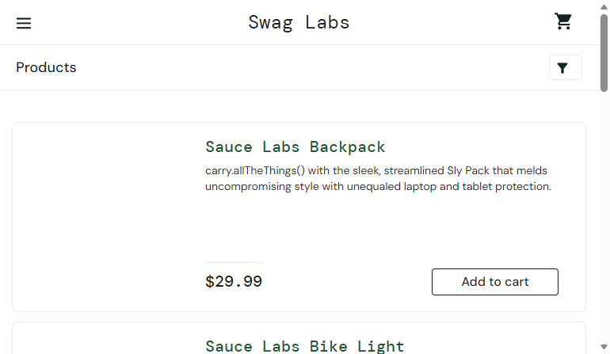
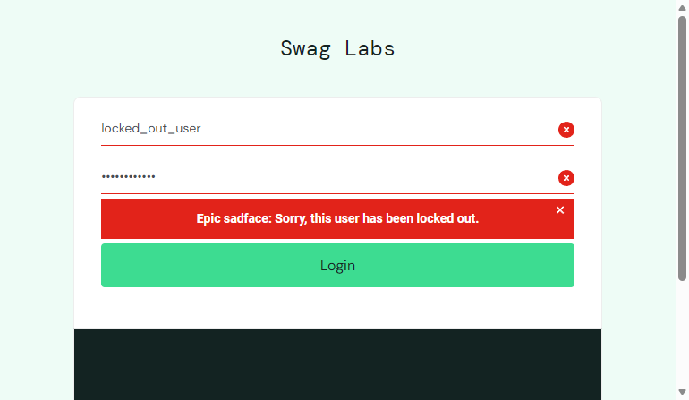
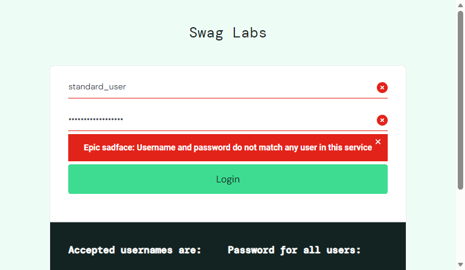
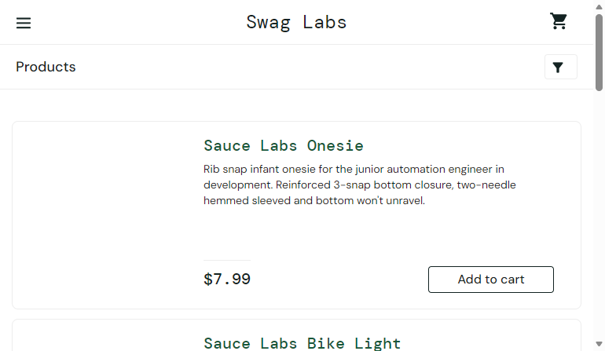
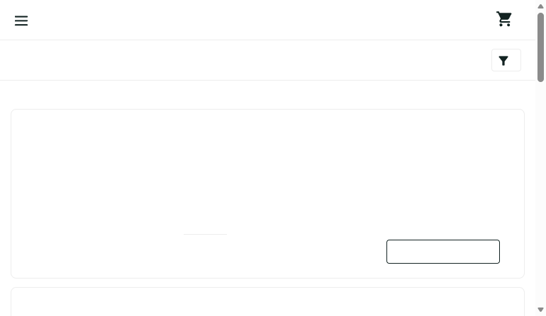
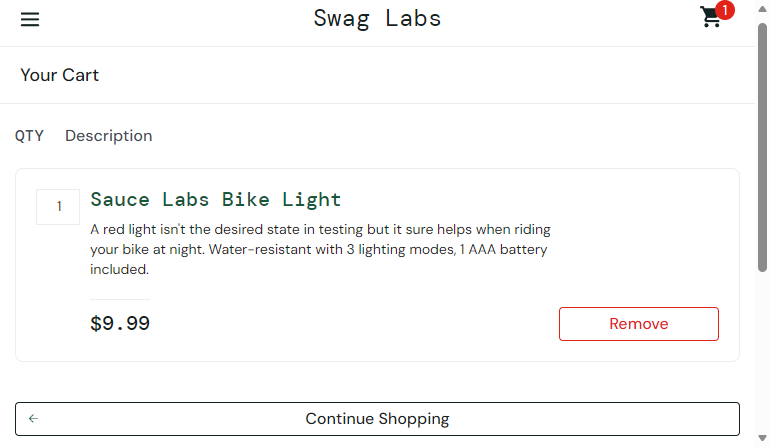
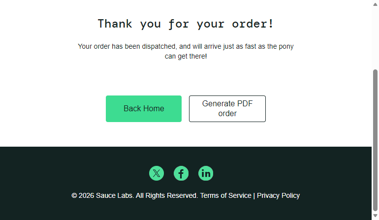
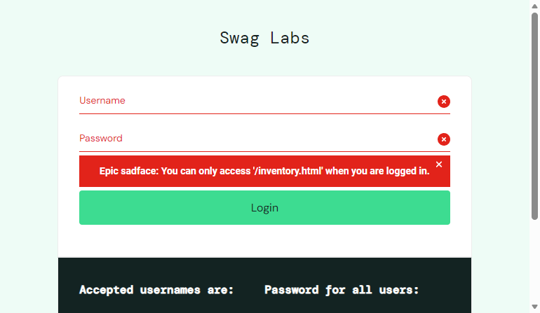

# Báo cáo thực hành Selenium WebDriver
**Người thực hiện:** Nguyễn Xuân Thanh  
**Website kiểm thử:** [SauceDemo (Swag Labs)](https://www.saucedemo.com/)  
**Công cụ sử dụng:** Python, Selenium WebDriver, Pytest  

---

## 1. Hướng dẫn cài đặt & chạy kiểm thử

```bash
# 1. Cài đặt các thư viện cần thiết
pip install -r requirements.txt

# 2. Chạy toàn bộ các test case
pytest
```

---

## 2. Danh sách và kết quả các Test Case

| Mã TC | Tên Test Case | Mô tả kiểm thử | Kết quả |
| :---: | :--- | :--- | :---: |
| **TC01** | `test_tc01_valid_login` | Đăng nhập thành công với tài khoản hợp lệ | **PASSED** |
| **TC02** | `test_tc02_locked_out_user` | Đăng nhập thất bại với tài khoản bị khóa | **PASSED** |
| **TC03** | `test_tc03_invalid_password` | Đăng nhập thất bại khi nhập sai mật khẩu | **PASSED** |
| **TC04** | `test_tc04_sort_price_low_to_high` | Sắp xếp sản phẩm theo giá tăng dần | **PASSED** |
| **TC05** | `test_tc05_sort_price_high_to_low` | Sắp xếp sản phẩm theo giá giảm dần | **PASSED** |
| **TC06** | `test_tc06_add_and_remove_products_cart` | Quản lý giỏ hàng: Thêm và xóa sản phẩm | **PASSED** |
| **TC07** | `test_tc07_complete_checkout_e2e` | Toàn bộ luồng đặt hàng và thanh toán (E2E) | **PASSED** |
| **TC08** | `test_tc08_logout_and_session_invalidation` | Đăng xuất và chặn truy cập trái phép | **PASSED** |

---

## 3. Chi tiết thực hiện & Ảnh minh chứng từng Test Case

### TC01: Đăng nhập thành công với tài khoản hợp lệ
- **Các bước thực hiện:**
  1. Mở trang đăng nhập `https://www.saucedemo.com/`.
  2. Nhập Username: `standard_user`, Password: `secret_sauce`.
  3. Bấm nút **Login**.
- **Kết quả mong đợi:** Đăng nhập thành công, chuyển hướng đến trang `/inventory.html` và hiển thị tiêu đề "Products".
- **Kết quả thực tế:** **PASSED**.
- **Hình ảnh minh chứng:**



---

### TC02: Đăng nhập thất bại với tài khoản bị khóa
- **Các bước thực hiện:**
  1. Mở trang đăng nhập.
  2. Nhập Username bị khóa: `locked_out_user`, Password: `secret_sauce`.
  3. Bấm nút **Login**.
- **Kết quả mong đợi:** Hiển thị thông báo lỗi: *"Epic sadface: Sorry, this user has been locked out."*.
- **Kết quả thực tế:** **PASSED**.
- **Hình ảnh minh chứng:**



---

### TC03: Đăng nhập thất bại với sai mật khẩu
- **Các bước thực hiện:**
  1. Mở trang đăng nhập.
  2. Nhập Username: `standard_user`, mật khẩu sai: `wrong_password_123`.
  3. Bấm nút **Login**.
- **Kết quả mong đợi:** Hiển thị thông báo lỗi: *"Epic sadface: Username and password do not match any user in this service"*.
- **Kết quả thực tế:** **PASSED**.
- **Hình ảnh minh chứng:**



---

### TC04: Sắp xếp sản phẩm theo giá tăng dần (Low to High)
- **Các bước thực hiện:**
  1. Đăng nhập vào trang sản phẩm.
  2. Chọn bộ lọc sắp xếp: **Price (low to high)**.
  3. Kiểm tra thứ tự danh sách đơn giá hiển thị trên trang.
- **Kết quả mong đợi:** Danh sách giá hiển thị theo đúng thứ tự tăng dần ($7.99 -> $49.99).
- **Kết quả thực tế:** **PASSED**.
- **Hình ảnh minh chứng:**



---

### TC05: Sắp xếp sản phẩm theo giá giảm dần (High to Low)
- **Các bước thực hiện:**
  1. Đăng nhập vào trang sản phẩm.
  2. Chọn bộ lọc sắp xếp: **Price (high to low)**.
  3. Kiểm tra thứ tự danh sách đơn giá hiển thị trên trang.
- **Kết quả mong đợi:** Danh sách giá hiển thị theo đúng thứ tự giảm dần ($49.99 -> $7.99).
- **Kết quả thực tế:** **PASSED**.
- **Hình ảnh minh chứng:**



---

### TC06: Quản lý giỏ hàng (Thêm và xóa sản phẩm)
- **Các bước thực hiện:**
  1. Thêm 2 sản phẩm: "Sauce Labs Backpack" và "Sauce Labs Bike Light" vào giỏ hàng.
  2. Kiểm tra biểu tượng giỏ hàng hiển thị badge số **2**.
  3. Chuyển vào trang giỏ hàng (`/cart.html`) và nhấn **Remove** sản phẩm "Sauce Labs Backpack".
- **Kết quả mong đợi:** Badge giỏ hàng giảm xuống còn **1**, sản phẩm bị xóa không còn trong giỏ.
- **Kết quả thực tế:** **PASSED**.
- **Hình ảnh minh chứng:**



---

### TC07: Luồng đặt hàng và thanh toán hoàn tất (E2E Checkout)
- **Các bước thực hiện:**
  1. Thêm sản phẩm vào giỏ hàng và bấm **Checkout**.
  2. Nhập thông tin giao hàng: First Name: `Nguyen`, Last Name: `Van A`, Postal Code: `70000` rồi bấm **Continue**.
  3. Kiểm tra trang tổng quan (Overview) hiển thị tổng tiền hợp lệ.
  4. Bấm nút **Finish** để xác nhận đơn hàng.
- **Kết quả mong đợi:** Chuyển sang màn hình hoàn tất và hiển thị thông điệp: *"Thank you for your order!"*.
- **Kết quả thực tế:** **PASSED**.
- **Hình ảnh minh chứng:**



---

### TC08: Đăng xuất và kiểm tra bảo mật phiên
- **Các bước thực hiện:**
  1. Mở menu bên trái và bấm **Logout**.
  2. Xác nhận đã quay lại trang đăng nhập.
  3. Cố tình truy cập trực tiếp URL trang nội bộ `/inventory.html`.
- **Kết quả mong đợi:** Bị chặn truy cập và hệ thống báo lỗi: *"Epic sadface: You can only access '/inventory.html' when you are logged in."*.
- **Kết quả thực tế:** **PASSED**.
- **Hình ảnh minh chứng:**


